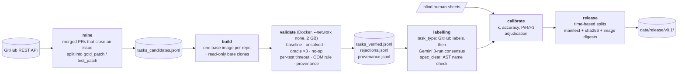

# RepoGym

[](https://github.com/iamrohitkumaryadav9/repogym/actions/workflows/tests.yml)

An RL environment and evaluation harness for coding agents, built from real GitHub pull requests.
Each task is an issue, a repository at the commit before the fix, and hidden tests that check
whether a patch fixes it. Every task is validated in Docker by three checks before it ships.

## Results (dataset v0.1)

| | |
|---|---|
| **Verified tasks** | **247** from 5 repos (click 71, astroid 67, tomlkit 45, isort 43, attrs 21) |
| **Funnel** | 1,794 merged PRs (3 years) → 271 candidates → 247 verified. **91.1%** of candidates survive validation |
| **Rejections (24)** | 19 nothing fails without the fix · 3 no runnable test file · 2 the fix doesn't make the tests pass |
| **FAIL_TO_PASS tests per task** | 1 test: 129 · 2–5: 88 · 6+: 30. Median diff 45 lines, median test run 1.75 s |
| **task_type** | bug 216 · feature 22 · other 5 · unknown 4 |
| **task_type sources** (precedence human > github > classifier) | human 30 · github 55 · classifier 158 · unknown 4 |
| **Task-type classifier vs human labels** | accuracy 0.90, **Cohen's κ 0.75** (n = 30) |
| **Task-type classifier vs GitHub labels** | accuracy 0.97, **κ 0.88** (n = 73) |
| **Classifier 3-run consensus** | label applied to 170 of 174 tasks without a GitHub label (3 dropped for disagreement, 1 for low confidence). Agrees with your labels on 12 of 12 overlapping tasks |
| **Classifier run-to-run stability** | all 3 runs agree on 171/174 tasks (**98.3%**); pairwise 516/522 (98.9%), temperature 0 |
| **Spec check vs human labels, blind** | precision 0.67 · recall 0.75 · **F1 0.71** (n = 25) |
| **Spec check, adjudicated** | precision 0.67 · recall 0.75 · **F1 0.71**. 3 false positives adjudicated; human labels upheld in all 3 |
| **spec_clear in the release** | 239 clear, 8 unclear. Source: 25 human, 222 heuristic |
| **Splits (primary, per repo by merge date)** | train 174 · dev 25 · test 48. Every repo is in every split, with 18.6–20.0% of each repo in test |
| **Global cutoffs (contamination view)** | `split_global`: train 172 (before 2026-07-10) · dev 25 · test 50 (on or after 2026-08-18) |
| **Docker disk (RepoGym only)** | 2.73 GB for 5 base images plus build cache (budget 10 GB) |

Primary split (`split`), per-repo counts and each repo's cutoff dates. A task is in dev if it
was merged on or after the repo's dev cutoff, and in test on or after its test cutoff (UTC dates):

| Repo | train | dev | test | dev cutoff | test cutoff |
|---|---|---|---|---|---|
| pallets/click | 49 | 8 | 14 | 2026-05-23 | 2026-07-01 |
| pylint-dev/astroid | 47 | 7 | 13 | 2026-08-01 | 2026-08-26 |
| python-poetry/tomlkit | 32 | 4 | 9 | 2026-07-14 | 2026-07-16 |
| PyCQA/isort | 31 | 4 | 8 | 2026-09-27 | 2026-10-21 |
| python-attrs/attrs | 15 | 2 | 4 | 2025-07-28 | 2025-08-04 |
| **Total** | **174** | **25** | **48** | | |

Validation and labelling details: [validity checks](#the-three-validity-checks),
[task type and spec clarity](#task-type-and-specification-clarity),
[classifier](#llm-task-type-classifier) and [release](#releases).

## Architecture



## Reproduce

Requires Docker, [uv](https://docs.astral.sh/uv/), a GitHub token with public read access, and a
Gemini API key for the labelling stage. Put them in `.env`, which is gitignored:

```bash
GITHUB_TOKEN=...
GEMINI_API_KEY=...
GEMINI_MODEL=gemini-3.5-flash-lite
GEMINI_FALLBACK_MODEL=gemini-3.5-flash-lite
```

One command per stage. `make reproduce` runs them all in order:

```bash
uv sync --locked                          # make install
uv run pytest                             # make test: unit tests, no network or Docker
uv run repogym mine                       # make mine: ~35 min uncached, ~3,100 GitHub API requests
uv run repogym build                      # make build: bare clones + 5 base images, ~4 min
uv run repogym validate --workers 2       # make validate: ~75 min for 271 candidates
uv run repogym stats                      # make stats
uv run repogym classify-consensus         # make label: ~520 Gemini requests; resumable
uv run repogym calibrate                  # make calibrate: vs data/labelling/ human labels
uv run repogym release v0.1 --dry-run     # make release-dry: build + validate in a temp dir
```

`make FAST=1 reproduce` is a ~30-second smoke test of every stage. It never touches `data/`,
never calls Gemini and never rebuilds images:

* `mine` uses one repo from the API cache and writes to `build/fast/`.
* `build` only checks the images and base commits.
* `validate` runs one task in Docker into a scratch directory.
* `label` summarises the saved classifier runs.

Every stage is cached or resumable. Mining caches every API response. Validation and labelling
fsync each result as it finishes, and a rerun skips completed work. The human labels used for
calibration are committed in `data/labelling/`. Their definitions are in
[docs/labelling_guidelines.md](docs/labelling_guidelines.md).

## Design decisions & limitations

**Time-based splits, per repo, plus global cutoffs for contamination.** Every task is a public
PR, so a model trained on data collected after a task's merge date may have seen the issue, the
discussion and the fix. That would inflate its score without measuring the skill the task is meant
to test. Splits are therefore by merge date, never random, and a UTC date is never split. Each task
carries two views:

* **`split` (primary, for balanced evaluation)**: within each repo, its newest ~20% of tasks are
  test, the next ~10% dev, and the rest train. Each repo has its own cutoff dates, recorded in the
  manifest. Every repo appears in every split, and no repo dominates test. A single global cutoff
  would put 23 of 50 test tasks in isort, the most active repo recently, and none in attrs.
* **`split_global` (secondary, for contamination analysis)**: one set of cutoff dates for all
  repos (test on or after 2026-08-18, dev on or after 2026-07-10). Per-repo test cutoffs range
  from 2025-08-04 (attrs) to 2026-10-21 (isort), so the primary test split is *not* uniformly
  recent. When a claim depends on recency, use `split_global` or the merge dates directly.

Each task records `merged_at`. When we evaluate agents, we will also report results separately on
tasks merged after each model's published training cutoff, where one is known. Those are the
results least exposed to this kind of leakage.

**One classifier model, chosen because of rate limits.** The first calibration run used
`gemini-3.8-flash` as the primary. It hit 309 HTTP 429 responses on 85 tasks, consistent with
free-tier limits, and 79 labels fell back to `gemini-3.5-flash-lite` anyway. To keep every label
from one model, `gemini-3.5-flash-lite` is the only model used for dataset labels. `gemini-3.8-flash`
is kept for an optional comparison run (`--model`), and its earlier answers stay cached under their
own key.

**Temperature 0 is not deterministic, hence 3-run consensus.** Re-requesting the 79 calibration
labels at temperature 0 changed 2 labels, 10 confidences and nearly every rationale. So a single
answer is not trusted. Each unlabelled task gets 3 independent runs, each cached under its own run
index. A label is applied only if all 3 agree and every confidence is ≥ 0.9; anything else stays
`unknown`. Answers that are incomplete (no candidates, empty text, or a `finishReason` other than
STOP) or schema-invalid are failures. They are never cached and never turned into a guessed label.
Precedence is human > GitHub labels > classifier, and every task records its `task_type_source`.

**The spec check has two known limitations.** It flags tasks whose tests use a new public name
(an import, attribute, keyword or CLI option) that the fix introduces and the issue never mentions.

1. *It is stricter than human judgement on some new names.* It flagged `isort-2626`
   (`STRING_PREFIXES`), `attrs-1255` (`PY_3_13_PLUS`) and `attrs-1457` (`force_kw_only`). On
   adjudication, a human upheld "clear" for all three; the reasons are in
   `data/labelling/spec_adjudication.csv`.
2. *It detects new names, not behavioural underspecification.* It missed `click-3695` (the tests
   expect deprecation warnings) and `attrs-1221` (the tests also require `super()` access).

The check is unchanged. Where a human label exists it is used (`spec_clear_source = "human"`).
Planned work: tell test-helper and internal imports apart from public-API names, and add an
LLM-assisted judge for behavioural underspecification.

**Timeouts and out-of-memory.** Each test gets 30 s (`pytest-timeout`). A test that hits it counts
as FAILED, so a bug that hangs gives a normal failing test. Each container gets 300 s, as a
backstop. Every listed test must finish in under 10 s in all three oracle runs, so a slow but
correct fix can't fail on a busier machine. Containers have 2 GiB of memory. If the unsolved or
no-op run is OOM-killed, the test that was running counts as FAILED, but only if all three oracle
runs peak below 50% of the limit. Otherwise the task is rejected, because the test may simply be
too heavy for the container. An OOM in the baseline or oracle runs is never excused. One task,
`astroid-2596`, is verified under this rule: it peaks at 2 GiB without the fix and 68 MiB with it.

**One image per repo, not per commit.** This keeps disk under 3 GB. Test dependencies are pinned
per repo and installed offline, and the repo's code comes from a read-only bare clone at
`base_commit`. Old commits whose tests need different dependency versions fail validation rather
than getting a custom image. Tests that fail at the base commit are excluded from both test lists
and logged.

**Other limitations.** Five pure-Python repos with fast test suites; no compiled extensions and no
other languages. FAIL_TO_PASS size is reported, not filtered: 129 tasks have a single
FAIL_TO_PASS test, which gives a sparser reward signal. The classifier calibration labels came
from a single run, so their κ predates the 3-run rule.

---

## Details

### Mining

`repogym mine` lists closed pull requests created in the last three years and keeps merged ones that:

1. **Link to an issue.** It looks for GitHub closing keywords ("fixes #N", "closes owner/repo#N", or
   an issue URL) in the title and body, ignoring HTML comments and code, where PR templates show
   placeholder examples. If there are none, it reads the PR timeline for issues linked by hand in the
   Development sidebar (`connected` events, minus later `disconnected` ones). The linked issue must
   be closed, in the same repo, and an issue rather than a pull request.
2. **Change both a source file and a test file.** Paths in a `test`/`tests` directory are tests; paths
   under the repo's package directory are source; anything else (docs, changelogs, config, lock
   files) goes in neither patch.
3. **Change fewer than 300 lines** of source and test code combined.

PRs with binary changes are also dropped, because a binary change can't be applied from a text diff.
The PR's diff is split into `gold_patch` (source files) and `test_patch` (test files), and
`base_commit` is the PR's base SHA. Every API response is cached under `data/cache/`, so reruns
make almost no requests. The client sleeps until the rate limit resets when it gets low, and backs
off on server errors. Per-filter drop counts are in `data/mining_report.jsonl`.

### Environments: one image per repo

Disk is limited, so there is **one image per repository, not per commit**. `repogym/<repo>:base` is
`python:3.11-slim` plus git and the repo's test dependencies, pinned in
`src/repogym/env/requirements/<repo>.txt`. It contains none of the repo's own code. Each image is
about 400–600 MB, and all five come to about 2.4 GB.

The code comes from a single bare clone per repo under `data/repos/`, mounted read-only into every
container. Each run starts a fresh container that:

1. creates `/work`, points it at the bare clone's objects (git alternates, so nothing is copied),
   and checks out `base_commit`;
2. checks out submodules from local mirrors (tomlkit's `toml-test` suite), so no network is needed;
3. runs `pip install -e .` offline, using the build backends baked into the image;
4. applies the patch under test, then `test_patch`, with `git apply`;
5. runs only the test files `test_patch` touches, and reports each test's result from pytest's JUnit
   XML.

Containers run with `--network none`, a 2 GB memory limit and 2 CPUs, and are always removed
afterwards. If setup fails (checkout, install, or a patch that doesn't apply), the
task is rejected with that stage as the reason, and validation carries on. Commit-specific images are
supported in the design but none have been needed. Every image build is logged to
`data/image_builds.jsonl`.

All builds go through a dedicated buildx builder, `repogym-builder` (docker-container driver,
images loaded into the local store with `--load`). Its build cache is therefore separate from
other projects' cache. `repogym clean --build-cache` prunes only that builder, and `repogym stats`
reports RepoGym-only disk (images, builder cache and the buildkit image) separately from total
Docker usage. The 10 GB budget applies to RepoGym-only usage.

Click's old tests break under pytest 9, which deprecates a parametrize pattern they use, and click
treats warnings as errors. Its base image therefore pins `pytest<9`, so no click task needs its own
image. Its image also installs `less`. Without it, one pager test closes the captured stdout, and
every later test in `tests/test_utils.py` errors during setup.

#### Timeouts

There are two timeouts, applied in exactly the same way to every run: the baseline, unsolved,
no-op and oracle checks, and any future agent runs, which use the same `run_tests` call.

* **30 seconds per test** (`pytest-timeout`, signal method). A test that hits it is recorded as
  **FAILED**, whether it hung in the test body or in a fixture. The rest of the file keeps
  running, so a bug that makes one test hang yields a normal failing test instead of a lost run.
* **300 seconds per container**, as a backstop for anything the per-test timeout can't interrupt.
  Hitting it rejects the task (`*_timeout`).

To keep a slow but correct fix from failing on a busier machine, every FAIL_TO_PASS and
PASS_TO_PASS test must finish in under 10 seconds (a third of the per-test timeout) in **all three**
oracle runs. Otherwise the task is rejected as `oracle_too_close_to_timeout`.

#### Out of memory

Each container has a 2 GiB limit, and each run records its peak memory use (cgroup
`memory.peak`) in `data/run_metrics.jsonl`. Some bugs make memory blow up before the per-test
timeout fires, and then the kernel kills pytest before it can write its JUnit report. To keep the
results of such runs, a small pytest plugin logs every test's result to a file as it goes.

When the **unsolved** or **no-op** run is OOM-killed:

* tests that finished keep their real results;
* the test that was running when memory ran out counts as **FAILED**;
* tests that never started are unknown, so they enter neither list.

This is allowed only if **all three oracle runs pass with peak memory under 50% of the limit**
(1 GiB). Otherwise, or if no test was recorded as running, the task is rejected as
`unsolved_out_of_memory`, because the OOM may come from a test that is simply too heavy for a small
container rather than from the bug. An OOM in the baseline or oracle runs is never excused. The rule
covers every future OOM case. For example, `astroid-2596` peaks at 2 GiB without the fix and
68 MiB with it.

### The three validity checks

For each candidate, the validator first runs a **baseline**: `base_commit` with no patches, running
the touched test files that already exist. Any test that fails there, or whose module fails to import
there, is an environment problem rather than part of the task. It can never enter either list, and
it is logged to `data/baseline_failures.jsonl`.

* **FAIL_TO_PASS**: fails, errors, or can't be imported with `test_patch` alone; passes with the fix.
* **PASS_TO_PASS**: passes with `test_patch` alone, and still passes with the fix.

1. **Unsolved-state check**: `base_commit + test_patch` must leave FAIL_TO_PASS tests failing. If
   nothing fails, the tests don't exercise the bug, and the task is rejected.
2. **Oracle check**: `base_commit + gold_patch + test_patch` must pass every FAIL_TO_PASS and
   PASS_TO_PASS test. This runs **three times**, and any test whose result differs between runs gets
   the task rejected as flaky.
3. **No-op check**: `base_commit + empty patch + test_patch`, as a separate run, must not count as
   solved. If some FAIL_TO_PASS tests pass here, the task is rejected as flaky.

Only tasks that pass every check are written to `data/tasks_verified.jsonl`. Every rejection is
written to `data/rejections.jsonl` with its reason and the first error message.

Validation is **resumable**. Each result is flushed to disk (fsync) as soon as it finishes, and a
rerun skips any task already in either file. If Docker itself fails, for example because the laptop
slept, the run stops without recording those tasks, so they are retried next time.
`repogym validate --retry <reason>` re-validates tasks rejected for a given reason, such as
`unsolved_timeout`. `--task <id>` re-validates single tasks from scratch, and `--all` re-validates
everything.

Every validated task, verified or rejected, gets a **provenance** record in
`data/provenance.jsonl`: the image name and its content-addressed id (`sha256:` of the image
config), the repogym git commit and whether the code had uncommitted changes, the pytest version in
the container, and the UTC time. The provenance is written before the result, so a recorded result
always has provenance.

### Task type and specification clarity

Every verified task carries three extra fields, set by `validate` and recomputed by
`repogym annotate`:

* **`task_type`**: `"bug"` or `"feature"` from the PR and issue labels (for example *Bug*,
  *Crash*, *Regression* versus *Feature*, *Enhancement*). No labels, or labels pointing both ways,
  give `"unknown"`. For those tasks, the LLM classifier (below) runs 3 times. Its label is applied
  in a release only on a confident consensus, and it can also be `"other"`. A human label from
  `data/labelling/` takes precedence over both. The release records which source each label came
  from in `task_type_source`.
* **`spec_clear`** and **`spec_issues`**: whether the issue tells an agent enough to pass the tests.
  The check (`repogym/spec.py`) parses the patched test files and collects what the *added* lines
  use from the library: names imported from the package, attributes, keyword arguments and
  `--cli-option` strings. A name is reported in `spec_issues` if it is public, is not defined in the
  package source at `base_commit`, is not defined by the tests themselves, appears in the gold
  patch's added lines (so the fix introduces it), and is not mentioned in the issue title or body.
  Attributes of builtins, common stdlib modules and pytest are ignored. Flagged tasks are kept,
  with `spec_clear=false`.

**Why underspecified tasks hurt RL reward quality.** The reward is "do the hidden tests pass".
If those tests need a name the issue never states, such as `PY_3_13_PLUS` or a keyword
`force_kw_only=`, a policy can only get the reward by guessing that exact name. A correct fix
under any other name scores the same as no fix, so the reward stops measuring whether the bug was
fixed. In RL this does two kinds of damage. It adds noise to the advantage estimate on otherwise
good trajectories. It also rewards the wrong habits: memorising upstream naming conventions, or
searching the repo and its history for hints about the tests. That is reward hacking, not issue
solving. Marking these tasks lets training down-weight or exclude them, and lets evaluation report
scores with and without them.

**Calibration and known limitations.** Against 25 blind human labels (all 9 flagged tasks plus 16
others), the check has precision 0.67, recall 0.75 and F1 0.71 for "underspecified". It produced 3
false positives, all adjudicated; the human labels were upheld in all 3 cases. The adjudication
reasons are in `data/labelling/spec_adjudication.csv`. Adjudicated precision, recall and F1 are the
same as the blind ones. The check has two known limitations:

1. **It is stricter than human judgement on some new names the tests use.** It flagged
   `PyCQA__isort-2626` (the tests import a new constant, `STRING_PREFIXES`),
   `python-attrs__attrs-1255` (a new compatibility flag, `PY_3_13_PLUS`) and
   `python-attrs__attrs-1457` (a new keyword, `force_kw_only`). A human judged that each issue
   describes the required behaviour well enough.
2. **It only detects new *names*, not behavioural underspecification.** It missed
   `pallets__click-3695` (the tests expect deprecation warnings the issue doesn't ask for) and
   `python-attrs__attrs-1221` (the tests also require `super()` access through `cached_property`).

The check has not been changed. In a release, `spec_clear` is the human label where there is one
(`spec_clear_source = "human"`, 25 tasks), and the check's result otherwise
(`spec_clear_source = "heuristic"`). Planned future work:

* Tell test-helper and internal imports (such as `attr._compat` flags) apart from public-API names.
* Add an LLM-assisted spec judge to catch behavioural underspecification.

FAIL_TO_PASS size matters too, but is only reported, not filtered. With a single test the reward
is effectively binary and easier to satisfy with a narrow special case. Tasks with several
FAIL_TO_PASS tests give a denser, harder-to-game signal. `repogym stats` reports how many tasks
have 1, 2–5, or 6+ FAIL_TO_PASS tests.

### LLM task-type classifier

`repogym classify` sends Gemini each task's issue title, issue body (template comments removed,
cut at a line break near 3,000 characters), PR title and PR labels. It asks for strict JSON:
`{"task_type": "bug"|"feature"|"other", "confidence": 0–1, "rationale": "..."}`.

* **Settings**: `GEMINI_API_KEY`, `GEMINI_MODEL` and `GEMINI_FALLBACK_MODEL` are read from `.env`,
  and the command stops if any is missing. The key is sent only in the `x-goog-api-key` header. It
  never appears in URLs, logs or the cache.
* **Retries**: HTTP 503, 429, 500 and network errors are retried up to 5 times, with exponential
  backoff (2, 4, 8, 16 s) and ±50% jitter. Other errors fail immediately. Only after the primary
  model's attempts are exhausted does it fall back to `GEMINI_FALLBACK_MODEL`, with the same policy.
* **Throttling and cache**: at most one request every 5 seconds (`--interval`). Successful
  responses are cached under `data/cache/llm/`, keyed by model, prompt version and prompt, so reruns
  cost nothing. A rerun always tries the primary model again before reusing a fallback answer, so
  fallback labels move to the primary model when it is available.
* **Validation**: a 200 response only counts if it has a candidate, non-empty text and
  `finishReason` `STOP`. SAFETY, MAX_TOKENS, RECITATION or a missing reason means the answer may
  be partial, so it counts as a failure. The JSON is then checked strictly: exact keys, a known
  `task_type`, a confidence in [0, 1] and a non-empty rationale. An answer is validated *before* it
  is cached, so nothing invalid is ever stored. A bad answer is retried once, fresh. After a second
  failure, or once every retry is exhausted, the task is `"unknown"` with the error recorded. A
  label is never guessed. `repogym llm-audit` re-checks every cache entry.
* **Determinism and provenance**: requests use temperature 0 and a response schema. Every label
  records the model, prompt version (`task-type-v1`), finish reason and whether it came from the
  cache. Calibration is reported separately per model.

**Official model: `gemini-3.5-flash-lite`.** The first calibration run used `gemini-3.8-flash` as
the primary. It hit 309 HTTP 429 (rate-limit) responses in 85 tasks, consistent with free-tier
limits, so 79 of the 85 labels came from the fallback anyway. To keep every label from one model,
`gemini-3.5-flash-lite` is now both `GEMINI_MODEL` and `GEMINI_FALLBACK_MODEL`, and the dataset's
task-type labels come only from it. `gemini-3.8-flash` is kept for an optional comparison run
(`repogym classify --model gemini-3.8-flash --out <file>`, which uses no fallback). Its earlier
answers stay in the cache under their own model key.

**Calibration before use.** `repogym sheets` writes two blind CSV sheets to `data/labelling/`.
They hide our own predictions, which go in a separate `*.key.json`.

* `task_type_sheet.csv`: 30 tasks (10 GitHub-labelled bugs, the feature-labelled ones, the rest
  unlabelled, spread across repos).
* `spec_sheet.csv`: every spec-flagged task plus a repo-stratified random sample, 25 in total,
  with an excerpt of the test patch.

After they are filled in, `repogym calibrate` reports the classifier's accuracy and Cohen's kappa
against the human labels and against GitHub labels, per model, and the spec check's precision and
recall against the human labels.

### Releases

`repogym release v0.1` freezes the verified tasks into `data/release/v0.1/`:

* `tasks.jsonl`: each task with its `split` (per repo) and `split_global`, PR `merged_at` and
  `created_at`, PR and issue URLs,
  `task_type` and `task_type_source`, and `spec_clear` and `spec_clear_source`. It also keeps the
  heuristic's own verdict (`spec_check_clear`, `spec_issues`).
* `manifest.json`: task count, per-repo counts, the SHA-256 of `tasks.jsonl`, the image digests,
  the release commit, the creation date, both split views (each repo's cutoff dates, and the
  global cutoffs) with per-repo counts per split, label-source counts, and the classifier model,
  prompt version and consensus rule. A `commits` record also gives the commit that validated the
  data (`0bb55ab`) and the commit that built the release. It lists the code changed in between
  and confirms that the validation code itself is unchanged. It also gives the commit that last
  wrote the validated data files, with their SHA-256, and confirms they are byte-identical to it.
  This makes it explicit that code changed after validation but the validated data did not.

A release refuses to overwrite an existing directory, and refuses to run while code or label
inputs have uncommitted changes. After writing, it re-reads the release and checks it against the
manifest: the hash, counts, image digests, split dates and label sources. `--dry-run` builds and
checks everything in a temporary directory and writes nothing to `data/release/`.

### WSL2 notes

* Keep the project in the Linux filesystem (`~/repogym`), not `/mnt/c`. Bind mounts and git are much
  faster there, and line endings stay LF.
* Turn on Docker Desktop's WSL integration for the distro. If `docker` reports permission denied
  right after doing so, open a new WSL session, because group membership only takes effect at login.
* `core.autocrlf=input` and `.gitattributes` (`eol=lf`) keep patches applying cleanly.
* With about 7.7 GB of RAM available to WSL, the default is 2 workers × 2 GB per container.
  `--workers` changes it.

